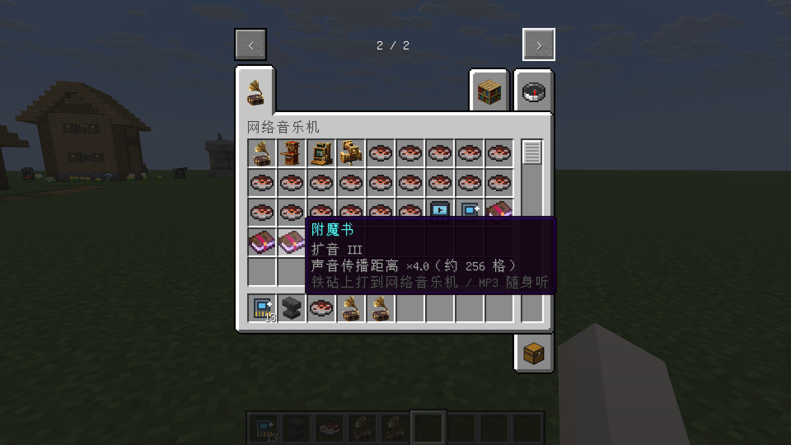
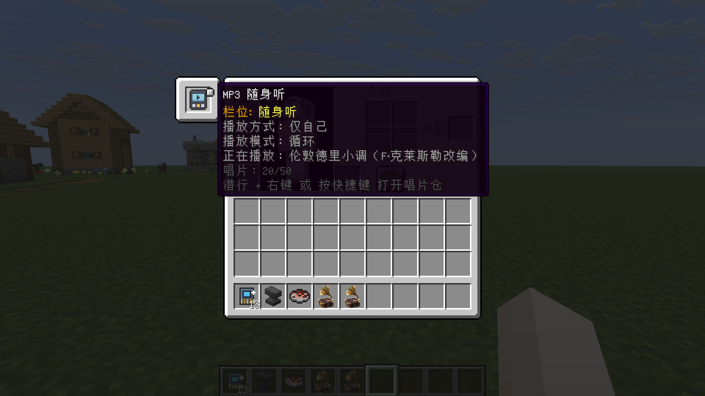
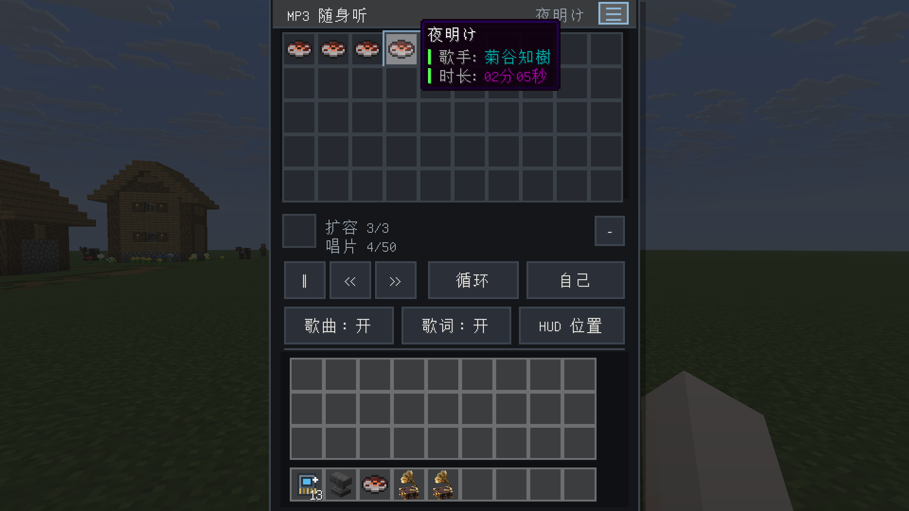
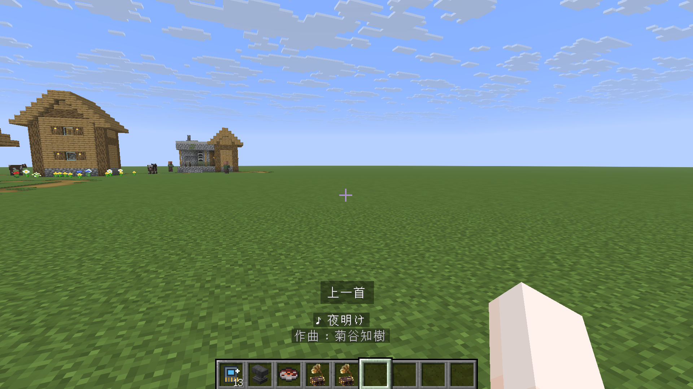

# Net Music Plus · 网络音乐机扩展

该MOD完全由Ai生成！！！！！

**给 [NetMusic](https://github.com/TartaricAcid/NetMusic) 加一副“更大的嗓门”，再加一台能装进口袋的唱片机。**

[中文](#中文) · [English](#english)

支持 Minecraft 1.20.1 / 1.21.1 / 26.1.2，覆盖 Forge、Fabric、NeoForge 三个加载器，共 6 个版本组合。

> **AI 生成声明**：本仓库的代码、数据文件与文档（含本 README）由 AI 编程助手生成，经文维护者审核并在游戏内测试后发布。使用前请自行评估风险，涉及存档与服务器的改动建议先在测试环境验证。本声明同样适用于 Releases 中的构建产物。

---

## 中文

### 简介

NetMusic 的网络音乐机把唱片里的在线音乐播放给附近玩家，声音传播距离固定为 64 格。本模组提供两样东西：

- **扩音附魔**：把网络音乐机的传播距离放大到 128 / 192 / 256 格。
- **MP3 随身听**：把唱片装进随身听，带在身上就能播放，界面可切换播放模式与播放方式，并在物品栏上方显示曲目与歌词。

### 演示

| 创造模式页签：三本附魔书、随身听与扩容件 | 从饰品栏打开唱片仓（20 格，正在播放） |
|---|---|
|  |  |
| **装满扩容后的唱片仓（4/50，悬停查看曲目信息）** | **物品栏上方的曲目与操作提示** |
|  |  |

### 内容

#### 扩音（Amplifier I / II / III）

| 等级 | 传播距离 |
|---|---|
| I | ×2（约 128 格） |
| II | ×3（约 192 格） |
| III | ×4（约 256 格） |

- 可附魔物品：`netmusic:music_player`（网络音乐机）、`netmusicplus:mp3_player`（MP3 随身听）。
- 使用方式：把附魔书和方块物品一起放进铁砧。同名附魔叠加时等级 +1，上限 III。
- 方块被破坏时等级写回掉落物，重新放置后继续生效。
- 安装 Jade 后，看向方块即可看到「扩音：II 级（可听 192 格）」。
- 只放大传播距离，不改变实际音量（原版音量超过 1 会被钳制为 1）。

#### MP3 随身听

- 20 个唱片位；`唱片扩容件` 每个增加 10 格，最多 3 个（上限 50 格）。每格只放一张唱片；扩容件可通过界面上的 `−` 按钮取下（要求它新增的 10 格为空）。
- 播放模式：循环 / 单曲 / 随机。播放方式：外放（附近玩家都能听到，半径受扩音附魔影响）/ 仅自己。
- 打开界面：`潜行 + 右键`，或按快捷键。界面一行 10 格，随容量自动加高。
- 快捷键（默认均未绑定）：
  - `MP3 随身听控制`：长按暂停 / 继续，单击下一首，双击上一首。
  - `打开 MP3 随身听`：直接打开唱片仓界面。
- HUD：切歌时曲名显示 1 秒后淡出，歌词持续滚动；位置可拖动保存；主题提供暗夜、木质、霓虹三种。
- 放在背包或饰品栏（Curios / Trinkets 的「随身听」槽位，位于胸甲栏位置）都能继续播放。

### 支持版本

| 目录 | Minecraft | 加载器 | mod 版本 | 构建 JDK |
|---|---|---|---|---|
| `versions/1.20.1-forge` | 1.20.1 | Forge 47.4.28 | 1.0.2 | Gradle 需 JDK 21，ForgeGradle 另需 JDK 17 |
| `versions/1.20.1-fabric` | 1.20.1 | Fabric Loader 0.16.14 / API 0.92.12 | 1.0.2 | 17 |
| `versions/1.21.1-neoforge` | 1.21.1 | NeoForge 21.1.259 | 1.2.9 | 21 |
| `versions/1.21.1-fabric` | 1.21.1 | Fabric Loader 0.20.1 / API 0.116.17 | 1.3.2 | 21 |
| `versions/26.1.2-neoforge` | 26.1.2 | NeoForge 26.1.2.122 | 1.0.3 | 25 |
| `versions/26.1.2-fabric` | 26.1.2 | Fabric Loader 0.20.1 / API 0.155.3 | 1.0.3 | 25 |

### 依赖

| 模组 | 必要性 | 版本 |
|---|---|---|
| NetMusic | 必需 | 1.5.2 及以上 |
| Jade | 可选，显示扩音等级 | 15.10.6 及以上 |
| Curios | 可选，提供「随身听」饰品槽 | Forge 5.14.1+ / NeoForge 9.5.1+ |
| Trinkets | 可选，提供「随身听」饰品槽 | 3.7.2+（1.20.1）/ 3.10.0+（1.21.1）/ 4.0.1+（26.1.2） |

### 合成

全部为无序合成。

| 产物 | 原料 |
|---|---|
| 扩音附魔书 I | 音符盒 + 铜锭 |
| 扩音附魔书 II | 音符盒 + 铜锭 + 紫水晶碎片 |
| 扩音附魔书 III | 音符盒 + 铜锭 + 紫水晶碎片 + 回响碎片 |
| MP3 随身听 | 网络音乐机 + 锁链 |
| 唱片扩容件 | 箱子 + 铁锭 |

### 配置

- Forge / NeoForge：`config/netmusicplus-common.toml`
- Fabric：`config/netmusicplus.json`
- HUD：`config/netmusicplus-hud.json`

| 键 | 默认值 | 含义 |
|---|---|---|
| `amplifier.level_1_multiplier` | `2.0` | I 级扩音倍率 |
| `amplifier.level_2_multiplier` | `3.0` | II 级扩音倍率 |
| `amplifier.level_3_multiplier` | `4.0` | III 级扩音倍率 |
| `mp3.out_loud_radius` | `64.0` | MP3 随身听外放的基础半径 |

### 构建

每个版本目录都是独立的 Gradle 工程，JDK 由 `JAVA_HOME` 决定（`org.gradle.java.home` 不写死在本仓库里）：

```bash
cd versions/1.21.1-fabric
JAVA_HOME=/path/to/jdk-21 ./gradlew build      # Windows: set JAVA_HOME=... 后 gradlew.bat build
```

产物在 `build/libs/` 下。

#### 需要自备的编译依赖（`libs/` 不随仓库分发）

把下列 jar 放到对应版本目录的 `libs/` 里：

| 目录 | 需要的 jar |
|---|---|
| `1.20.1-forge` | `netmusic-1.5.2-forge+mc1.20.1.jar`、`curios-forge-5.14.1+1.20.1.jar` |
| `1.20.1-fabric` | `netmusic-1.5.2-fabric+mc1.20.1.jar`、`trinkets-3.7.2.jar`、`cardinal-components-base-5.2.0.jar`、`cardinal-components-entity-5.2.0.jar`、`ForgeConfigAPIPort-v8.0.3-1.20.1-Fabric.jar`（`runClient` 需要） |
| `1.21.1-neoforge` | `netmusic-1.5.2-neoforge+mc1.21.1.jar`、`curios-neoforge-9.5.1+1.21.1.jar`、`Jade-1.21.1-NeoForge-15.10.6.jar` |
| `1.21.1-fabric` | `netmusic-1.5.2-fabric+mc1.21.1.jar`、`trinkets-3.10.0.jar`、`cardinal-components-base-6.1.0.jar`、`cardinal-components-entity-6.1.0.jar`、`Jade-1.21.1-Fabric-15.10.6.jar` |
| `26.1.2-neoforge` | `netmusic-1.5.2-neoforge+mc26.1.jar`（Curios 走 Maven，不用本地 jar） |
| `26.1.2-fabric` | `netmusic-1.5.2-fabric+mc26.1.jar`、`trinkets-4.0.1+26.1.jar`、`yumi-mc-foundation-1.0.1+26.1.jar` |

来源：NetMusic（GitHub Releases / CurseForge / Modrinth）、Curios（CurseForge）、Trinkets（Modrinth）；Cardinal Components、Yumi 可从对应 mod 的嵌套 jar 或 Maven 取。

### 实现要点

- **声音传播距离**：原版 `SoundEngine` 用 `max(volume, 1) * attenuationDistance`（`attenuationDistance` 默认 16）计算距离，NetMusic 的 `NetMusicSound` 把 `volume` 固定为 `4.0` ⇒ 64 格。扩音附魔在 `SoundInstance#getVolume()` 的返回值上乘倍率；音量超过 1 会被钳制，所以只放大范围，不变响。
- **播放包广播**：NetMusic 的 `NetworkHandler#sendToNearby` 把广播半径写死为 96 格，需同步按倍率放大，否则超出 96 格的玩家收不到播放数据。
- **等级持久化**：等级写入方块实体的自定义数据（Forge / NeoForge 用 `persistentData`，Fabric 用 mixin 加字段写进原有 NBT），随方块实体同步包下发到客户端，方块掉落时写回物品。
- **创造页签**：三个 Fabric 版 NetMusic 的页签 id 是 `netmusic:netmusic_group`，Forge / NeoForge 版是 `netmusic:netmusic`；三本附魔书由原版按附魔注册表自动生成，不额外注册。

### 许可证

MIT，见 [LICENSE](LICENSE)。

NetMusic 由 Tartaric Acid 开发，使用 MIT 许可证。本仓库不包含 NetMusic 的源码或 jar，构建所需见上文「需要自备的编译依赖」。

---

## English

**Bigger range for [NetMusic](https://github.com/TartaricAcid/NetMusic), plus a jukebox you can carry.**

NetMusic's music player plays online music to nearby players within a fixed 64-block radius. Net Music Plus adds an **Amplifier** enchantment that raises that distance to 128 / 192 / 256 blocks, and a portable **MP3 player** that stores up to 50 discs and shows the current track and lyrics above your hotbar.

> **AI-generated disclosure**: The code, data files and documentation in this repository (including this README) were produced with an AI coding assistant, then reviewed and tested in-game by the maintainer. Evaluate the risks yourself before use, and validate anything that touches saves or servers in a test world first. This disclosure also covers the build artifacts attached to Releases.

### Screenshots

| Creative tab: three books, the MP3 player and the expander | Disc bay opened from the trinket slot (20 slots, playing) |
|---|---|
|  |  |
| **Expanded disc bay (4/50, hovering a disc)** | **Track and action feedback above the hotbar** |
|  |  |

### Features

#### Amplifier (I / II / III)

| Level | Range |
|---|---|
| I | ×2 (about 128 blocks) |
| II | ×3 (about 192 blocks) |
| III | ×4 (about 256 blocks) |

- Applies to `netmusic:music_player` and `netmusicplus:mp3_player`.
- Combine the enchanted book with the block item on an anvil; the same enchantment stacks one level, capped at III.
- The level is written back to the dropped item when the block is broken, and restored when placed again.
- With Jade installed, looking at the block shows the level and its range.
- Only the audible distance grows; loudness is untouched (vanilla clamps volume above 1 to 1).

#### MP3 player

- 20 disc slots; each **Disc Expander** adds 10 slots, up to 3 expanders (50 slots). One disc per slot; an expander can be removed with the `−` button when the 10 slots it added are empty.
- Play modes: loop / single / shuffle. Output: out loud (everyone nearby hears it, radius affected by Amplifier) or personal.
- Open the GUI by sneaking and right-clicking, or with a key bind. 10 slots per row, the panel grows with capacity.
- Key binds (unbound by default): hold to pause/resume, single press for next, double press for previous; a second bind opens the GUI directly.
- HUD: the track title shows for one second after a track change, lyrics keep scrolling; the position is draggable and saved; three themes (Night, Wood, Neon).
- Works from your inventory or from the Curios / Trinkets trinket slot, positioned over the chestplate slot.

### Versions

| Directory | Minecraft | Loader | Mod version | Build JDK |
|---|---|---|---|---|
| `versions/1.20.1-forge` | 1.20.1 | Forge 47.4.28 | 1.0.2 | Gradle on JDK 21, ForgeGradle needs JDK 17 |
| `versions/1.20.1-fabric` | 1.20.1 | Fabric Loader 0.16.14 / API 0.92.12 | 1.0.2 | 17 |
| `versions/1.21.1-neoforge` | 1.21.1 | NeoForge 21.1.259 | 1.2.9 | 21 |
| `versions/1.21.1-fabric` | 1.21.1 | Fabric Loader 0.20.1 / API 0.116.17 | 1.3.2 | 21 |
| `versions/26.1.2-neoforge` | 26.1.2 | NeoForge 26.1.2.122 | 1.0.3 | 25 |
| `versions/26.1.2-fabric` | 26.1.2 | Fabric Loader 0.20.1 / API 0.155.3 | 1.0.3 | 25 |

### Dependencies

| Mod | Required | Version |
|---|---|---|
| NetMusic | Yes | 1.5.2 or newer |
| Jade | Optional, shows the amplifier level | 15.10.6 or newer |
| Curios | Optional, provides the trinket slot | Forge 5.14.1+ / NeoForge 9.5.1+ |
| Trinkets | Optional, provides the trinket slot | 3.7.2+ (1.20.1) / 3.10.0+ (1.21.1) / 4.0.1+ (26.1.2) |

### Recipes

All shapeless.

| Result | Ingredients |
|---|---|
| Amplifier Book I | Note Block + Copper Ingot |
| Amplifier Book II | Note Block + Copper Ingot + Amethyst Shard |
| Amplifier Book III | Note Block + Copper Ingot + Amethyst Shard + Echo Shard |
| MP3 Player | NetMusic music player + Chain |
| Disc Expander | Chest + Iron Ingot |

### Configuration

`config/netmusicplus-common.toml` on Forge / NeoForge, `config/netmusicplus.json` on Fabric, and `config/netmusicplus-hud.json` for the HUD.

| Key | Default | Meaning |
|---|---|---|
| `amplifier.level_1_multiplier` | `2.0` | Level I range multiplier |
| `amplifier.level_2_multiplier` | `3.0` | Level II range multiplier |
| `amplifier.level_3_multiplier` | `4.0` | Level III range multiplier |
| `mp3.out_loud_radius` | `64.0` | Base out-loud radius of the MP3 player |

### Building

Each directory under `versions/` is a standalone Gradle project; the JDK comes from `JAVA_HOME`:

```bash
cd versions/1.21.1-neoforge
JAVA_HOME=/path/to/jdk-21 ./gradlew build
```

Compile-time jars in `libs/` are not distributed with this repository — see the table in the Chinese section for the exact file names.

### Notes on the implementation

- The audible radius is `max(volume, 1) * attenuationDistance` (16 by default). NetMusic hardcodes `volume = 4.0`, which gives the vanilla 64 blocks; the enchantment multiplies the value returned by `SoundInstance#getVolume()`.
- NetMusic's `NetworkHandler#sendToNearby` broadcasts with a hardcoded 96-block radius, which has to be scaled as well, otherwise clients beyond 96 blocks never receive the packet.
- The level lives in block entity custom data (`persistentData` on Forge / NeoForge, a mixin-injected field written into the vanilla NBT on Fabric), is synced to clients with the block entity update packet, and is written back to the item on drop.
- The NetMusic creative tab id is `netmusic:netmusic_group` on Fabric and `netmusic:netmusic` on Forge / NeoForge. The three books are generated by vanilla from the enchantment registry, so no extra tab entries are registered.

### License

MIT — see [LICENSE](LICENSE). NetMusic is developed by Tartaric Acid under the MIT license; this repository contains neither its source nor its jars.
